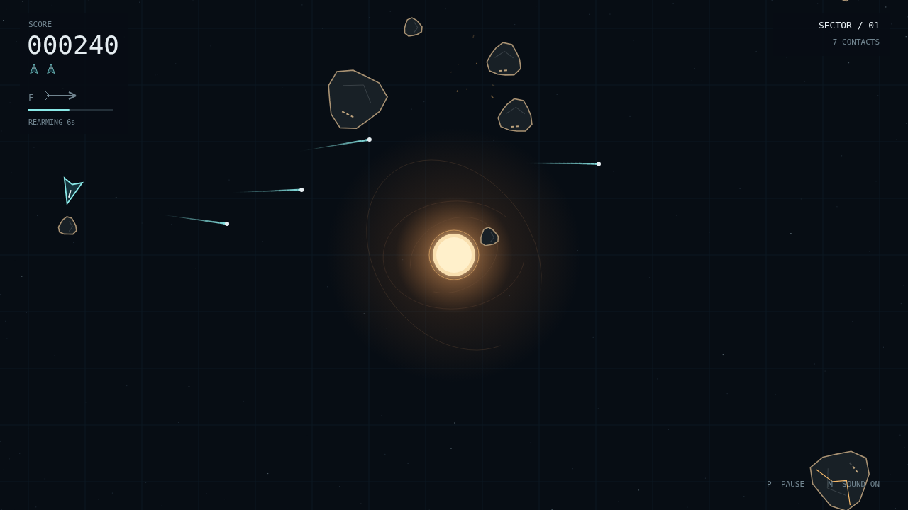

# Shatter

One ship. A field of armored rock. A star that bends every shot you fire. Shatter is a momentum-driven space shooter where the shortest line to a target is rarely the most interesting one.

Turn, burn, and let yourself drift. Work the edges of the wrapping field, break large rocks into smaller ones, then chase down the last fragments to clear the wave. Cracks tell you when the armor is close to giving way. Every new wave brings more rock moving faster.

The gravity well keeps the field alive. Bullets curve toward its bright core, and rocks tumble through changing orbits. A rock swallowed by the star returns from an edge, so the well never does your work for you. Your ship ignores the pull and slides along the core.

When there is no time to chip away, commit your warhead. A single guided torpedo finds a target in front of you, holds its course through the well, and breaks any rock on impact. Then survive the ten-second recharge—and keep an eye out for the saucer hunting you.

